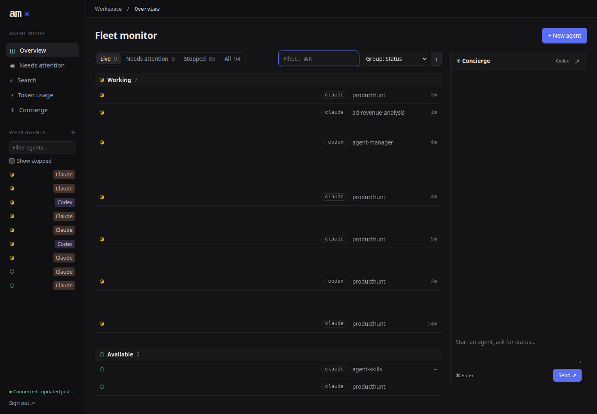
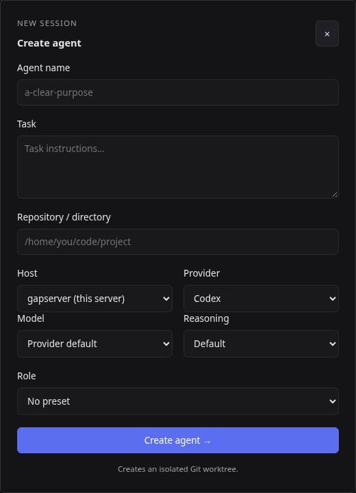
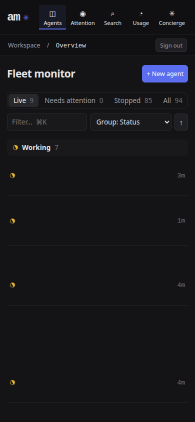

# Agent Motel functionality and UI review — 2026-11-09

Review target: `df7b071378af381399ce4fa5b00b9034f6cd25c1`, also the installed gapserver checkout. **Suggested order: ownership/provenance and parent-status correctness → bounded search/GC/remote work → message semantics → UI consistency.** This is a selection backlog, not an implementation or deployment plan; no fixes are included.

**Priority:** P1 = correctness, authority, data preservation or major reliability; P2 = recurring friction; P3 = polish/expansion. **Evidence:** Live = observed read-only; Trace = code-confirmed path with an isolated reproduction scenario, not executed against the fleet; Mock = isolated in-memory reproduction. Effort is an estimate for implementation plus focused regression coverage.

## Evidence and limits

The initial CLI snapshot contained 95 registered agents: 86 exited, seven working, one waiting and one idle. Counts changed during the audit; the web overview excludes the concierge from its ordinary-agent count. Sequential wall-clock samples below are observations, not a controlled benchmark, and do not establish that simultaneous GC/sidebar/dev-pool activity caused a specific timeout.

| Read-only command | Elapsed | Result |
| --- | ---: | --- |
| `am summary` | 0.24s | Fleet summary returned |
| `am ls --json` | 0.67s | 95 registered agents |
| `am role list` | 0.04s | Caretaker and concierge; exported native roles are separate |
| `am queue am-functionality-review` / `am comms am-functionality-review` | 0.05s / 0.06s | Empty queue / no recorded messages |
| `am peek web-ui-claude-questions --lines 20` | 0.06s | Prior rollout report visible |
| `am search 'am:' --all --limit 8 --json` | 37.42s | Results included real errors and unrelated substring hits |
| Same search for `timed out`, `unknown`, `failed` | 19.79s / 16.49s / 14.51s | Mostly noisy recent results |
| Same search for `permission` | 11.30s | Exit 1: `Cannot create a string longer than 2147483647 characters` |
| `nice -n 15 am gc` | 30.83s | Dry run: 73 clean worktree removal candidates, 23 kept worktrees |

Browser checks used the existing HTTPS front desk from gapserver at 1440×1000 and 390×844: sign-in, overview/status filters, sidebar/filter, Ctrl-K, attention, details search, token usage, create dialog/catalogs, the audit agent's terminal/chat, context menu, handover and rename/move forms. Forms were inspected and dismissed without submission; no terminal keys, messages, approvals or lifecycle operations were sent. The concierge dock was inspected without invoking its create/revive control. No live pending Claude question was available. Terminal-hub behavior was inspected in source/docs, not by sending input to another agent's pane. Remote-host forms were inspected, but no host outage or transfer was induced.

Read README, current UI/search/lifecycle/remote documentation, source and relevant tests. Mined the five requested historical search terms and selected AM/concierge handoffs, especially the November 2 concierge history and October 29 UI handoff. The private friction backlog had no existing items when queried; the newly observed search failure was recorded there separately. Raw transcripts, private tasks and credentials are intentionally absent from this public report. No full test suite or destructive reproduction was run; use `scripts/test-isolated.py` for future tests on a live-fleet host.

## Bugs (with repro)

Each Trace repro belongs in a temporary HOME/state directory/tmux socket. Never reproduce cleanup or authority defects against the operator's live agents.

| ID / priority | Finding, repro and concrete suggestion | Evidence / effort |
| --- | --- | --- |
| B01 · P1 | **Historical search can exhaust string capacity.** Run the `permission` query above on the large corpus; even `--limit 8` crashes. Stream and bound rg output/line sizes, and return explicit partial results instead of building one giant string. [Search buffering](../src/search.ts#L178), [late limit](../src/search.ts#L317). | Live · 1–2d |
| B02 · P1 | **Self-send loses agent provenance.** In a fixture, attribute a managed agent's message to itself, then pass it through hook/idle-Claude delivery: it becomes unwrapped and can receive operator treatment. Preserve an explicit sender kind independent of text. [Attribution](../src/comms.ts#L169), [inbox framing](../src/commands/hook.ts#L154), [delivery](../src/deliver.ts#L653). | Trace · 1–2d |
| B03 · P1 | **Queued peer text can contaminate trusted hook context.** Feed a multiline peer message containing authority-like text through prompt/tool/Stop inbox formatting; raw body and verification prose share the context channel. Encode boundaries and provenance; adversarial fixtures must distinguish bodies from am-authored notes. Model compliance/exploitation was not tested. [Formatter](../src/commands/hook.ts#L165), [Stop path](../src/commands/hook.ts#L246). | Trace · 1–2d |
| B04 · P1 | **A child Stop can mark its active parent idle.** Supply a Stop payload carrying `agent_id` while the parent works: status updates and runtime clearing still run. Gate parent lifecycle changes on parent events, including receipt and conditional-stop checks. [Hook](../src/commands/hook.ts#L728), [runtime](../src/commands/hook.ts#L772). | Trace · 1–2d |
| B05 · P1 | **GC misses owners registered inside a worktree subdirectory.** Register an in-place owner at `worktree/frontend` without `worktreePath`; planning compares only the worktree root and can nominate it. Resolve ownership to the linked-worktree root. [References](../src/gc.ts#L234), [comparison](../src/gc.ts#L181). | Trace · ½–1d |
| B06 · P1 | **GC does not recheck ownership before removal.** Plan an unowned clean worktree, then register an owner before applying the plan; application only asks Git to remove it. Revalidate ownership under coordination with registration immediately before deletion. [Application](../src/gc.ts#L297). | Trace · 1–2d |
| B07 · P1 | **Detached work can lose its last protective reference.** Plan a clean detached worktree whose commits are not reachable from a branch; it is removable despite the “branches stay” reassurance. Keep it unless durable commit reachability is proven. [Scan](../src/gc.ts#L199), [metadata](../src/commands/move.ts#L192). | Trace · ½d |
| B08 · P1 | **`rm --clean` can remove another agent's shared checkout.** Start fixture B in-place in A's worktree, then clean-remove A: removal is forced without checking B. Protect all live/restorable root and descendant owners, and require separate handling of dirty files. [Removal](../src/commands/rm.ts#L146). | Trace · 1d |
| B09 · P1 | **GC does not count dev-pool previews as owners.** Retain a pinned lease after its AM owner/trash expires; GC may nominate its clean source checkout. Consult leases before removal; the external pool currently treats a missing worktree as reclaimable before checking its pin. [AM references](../src/gc.ts#L238); inspected `start-dev/dev-pool.mjs:734–745`. | Trace, external integration · 1d |
| B10 · P1 | **Async SSH deadlines need not settle the request.** Mock a killed child whose stdout stays open: a 10ms deadline remained pending at 60ms, returning 124 only after stream closure. Bound stream draining and process exit together, cancel readers, and clear timers in `finally`. [Runner](../src/remote.ts#L242). | Mock · ½–1d |
| B11 · P2 | **Remote stop/remove can freeze the hub.** With a fixture SSH command that connects but never exits, synchronous handlers have no operation deadline. Convert them to bounded asynchronous actions with visible progress. No live stop/remove was attempted. [Hub actions](../src/commands/ui.ts#L426). | Trace · ½d |
| B12 · P2 | **“Queue until idle” actually reaches a running turn.** Queue ordinary text while a fixture parent works; its next PostToolUse drains it into context. Make ordinary queue delivery wait for the turn boundary, or explicitly rename/document the current behavior across CLI and web. [Hook contract](../src/commands/hook.ts#L170), [drain](../src/commands/hook.ts#L308). | Trace · 1d |
| B13 · P2 | **Concierge revival can choose an unrelated session.** Revive an exited concierge with no captured session ID; generic revival can use provider “last/continue” in the shared home directory. Require an exact ID, matching caretaker's guard. [Revival call](../src/commands/concierge.ts#L148). | Trace · ½d |
| B14 · P2 | **Concierge provider badge is hardcoded.** Open the overview with a Claude concierge: the dock says Codex. Populate provider/status from the resolved concierge row. [Markup](../web/index.html#L200), [screenshot](images/functionality-review-2026-11/ctrl-k.png). | Live + trace · 20–40m |
| B15 · P2 | **Remote search failures silently look like no matches.** Make one fixture host time out during `--fleet`; its results disappear without a partial/unreachable signal. Return per-host completeness and warn in text/JSON/UI. [Federation](../src/search.ts#L350). | Trace · ½–1d |

## Quick wins (<1h each)

| Priority | Concrete suggestion |
| --- | --- |
| P2 | Fix B14's provider badge first; do not overwrite persistent identity with transient “Message accepted” text. |
| P2 | Standardize Ctrl-K in the README and hub footer, documenting Ctrl-P as the legacy alias; the web shortcut currently focuses a filter rather than opening commands. [README](../README.md#L20), [picker](../src/picker.ts#L854). |
| P2 | Add a targeted “did you mean `gpt-6-astra`?” suggestion for rejected `astra`, using the installed catalog; retain exact model validation and avoid silently guessing ambiguous names. [Validation](../src/catalog.ts#L296). |
| P2 | Distinguish AM roles from exported native subagent roles in `am role list` help; it currently lists caretaker/concierge while README also describes engineer/reviewer/shepherd. [Exported defaults](../src/subagentRoles.ts#L112). |
| P2 | Correct `docs/search-plan.md`'s “safe at any size” claim and old 46ms baseline; explain that `--limit` presently caps returned results, not scan work. [Historical plan](search-plan.md). |
| P2 | Clarify the create dialog's worktree promise: show the selected host and default base, and say that non-Git directories do not create a Git worktree. [Create screenshot](images/functionality-review-2026-11/create.png). |
| P3 | Add short UI wording explaining that the concierge is excluded from the ordinary-agent count, and that “Available/Stopped” correspond to CLI `idle/exited`. |
| P3 | Add a troubleshooting index linking folder trust, exact session revival, remote version mismatch, lifecycle audit and isolated tests; keep the long API reference outside the onboarding path. |

## Improvements (with rough effort)

| Priority / effort | Concrete suggestion and evidence |
| --- | --- |
| P1 · 1–2d | **Budget GC inspection.** Cache repository metadata; bound Git execution and total scan time; show progress and conservatively keep uninspected paths. One dry run took 30.83s; scanning performs repeated synchronous metadata/status commands. [Scan](../src/gc.ts#L171). |
| P1 · 1–2d | **Bound shared Git polling.** Exclude `dead` as well as `exited`, cap concurrency, and coalesce work by repository/worktree. The three-second diff cache launches status and numstat probes per directory; a warm cache is not a global I/O budget. [Fleet](../src/fleet.ts#L571), [diff cache](../src/commands/ls.ts#L334). |
| P1 · 2–4d | **Make ownership explainable.** Add read-only `am gc --json` / `am workspace owners <path>` showing registry, normalized cwd, trash and external lease evidence. Treat home-directory registrations as “ownership unknown,” not proof that a similarly named worktree is free. |
| P2 · 1–2d | **Make search useful for incidents.** Add agent/date/role filters and self-exclusion; rank actual user/assistant matches above code dumps, and display match time rather than only transcript mtime. Live `am:` matched suffixes in unrelated code and this audit's own prompt. [Ranking](../src/search.ts#L296). |
| P2 · 1–2d | **Expose message delivery state consistently.** Show queued, delivered-to-context, turn-finished and interrupted separately, with receipt ID/cancel controls; “done” must not imply that the requested work succeeded. Preserve queue vs steer semantics from B12. [Existing API contract](../README.md#http-api). |
| P2 · 1–2d | **Explain status and exits.** Show last hook/event, timestamp, pending permission and unknown/stale status; link stop reasons to the existing lifecycle audit instead of treating “session disappeared” as operator action. [Audit](lifecycle-audit.md). |
| P2 · 1–2d | **Diagnose launch latency by phase.** Time remote catalog, fetch/worktree, role export, daemon attach and first provider prompt; expose retryability without spawning twice. Fast `ls` here does not reproduce reported loaded-host `new`/`ls` timeouts; do not “fix” this by only raising timeouts. |
| P2 · 1–2d | **Expose remote capability/freshness.** Show each host's last success, version/capabilities and partial data state, with one coherent operation budget; test older/offline hosts without freezing local controls. [Remote guide](reverse-ssh.md), [web compatibility](web-ui.md). |
| P2 · ½–1d | **Align upload and HTTP deadlines.** Setup plus a 120-second transfer can exceed the server's 120-second idle timeout; use one request deadline and cancellation so a successful remote upload does not become an ambiguous client failure. [Upload](../src/remoteAgents.ts#L142), [server](../src/server.ts#L1091). |
| P2 · 1–2d | **Add a safe doctor command.** Check provider/catalog availability, daemon and hook version, trust-prompt state, exact resume ID and remote prerequisites without creating an agent; offer explicit next actions and preserve folder-trust guardrails. |

## UI/UX polish (with screenshots)

These are screenshots of the running UI, not fixture renders. Private agent names, tasks, subagent labels and transcript bodies were hidden in-page before capture; the resulting blank content areas are **redaction, not rendering defects**. The create image is cropped to the dialog. No credential appears in any image.

| Priority / effort | Suggestion |
| --- | --- |
| P2 · 1–2d | **One command palette across surfaces.** Ctrl-K in the browser currently returns to Overview and focuses its filter; the terminal hub opens commands. Offer agent search and safe navigation/actions in a true palette, retaining confirmation for destructive actions. [Handler](../web/app.js#L1745). |
| P2 · ½–1d | **Make separate search scopes explicit.** Sidebar filter, overview filter and Search page are independent; label “filter this list” versus “search conversations,” and preserve the user's query during navigation. |
| P2 · ½–1d | **Show queue depth and status text without hover.** Sidebar identity is mostly a colored dot plus provider; include compact queue/attention labels and make working/waiting distinguishable on touch and for color-blind readers. [Sidebar rendering](../web/app.js#L420). |
| P2 · ½–1d | **Expose safe message mode before sending.** The chat composer has a send arrow but no visible queue/steer choice; give the selected mode a text label and explain delivery when the agent is busy. |
| P2 · 1d | **Make prompt fallback actionable.** Keep the new question cards; for unsupported/multi-select/clipped menus show “terminal needed” with the exact reason, and keep attention discoverable in the sidebar. Never guess menu keys. [Supported layouts](web-ui.md#answering-claude-prompts). |
| P3 · ½–1d | **Improve create guidance.** Provide directory completion/discovery, display default branch behavior, and show catalog-loading/failure state before enabling launch. The current form is compact but assumes filesystem and provider knowledge. |
| P3 · ½d | **Use platform-appropriate shortcut labels.** The Linux desktop and mobile screenshots show ⌘K; use Ctrl on Linux/Windows and omit keyboard-only hints on touch layouts. |
| P3 · ½–1d | **Keep mobile orientation and action discoverability.** At 390px there was no horizontal overflow, but repository/provider context is reduced and hover explanations disappear; add a compact per-agent details/action affordance. |

### Desktop overview after Ctrl-K

Focus lands in the list filter. The dock's Codex label is static despite a Claude concierge. Blank rows/transcript areas are privacy redaction.

### Create form

Host/provider/model selection works; worktree/base/directory guidance remains sparse. The form was not submitted.

### Mobile overview

390×844, no horizontal overflow in this check. Private row content is hidden; keyboard-oriented hints remain visible.

## Bigger ideas

| Priority / effort | Concrete suggestion |
| --- | --- |
| P2 · 1–2 weeks | **One bounded observation service.** Have daemon/API/hub/dev-pool consume versioned snapshots of status, worktree ownership and diffs, with freshness and per-host budgets; avoid each consumer launching its own filesystem work. |
| P2 · 1–2 weeks | **Typed message envelopes end to end.** Separate actor kind, sender, verified transport metadata, receipt and untrusted body; render the same queue/steer semantics in hooks, CLI and browser. Same-account processes remain outside a strong security boundary. |
| P2 · 1 week | **Cleanup as a reviewable proposal.** Let caretaker produce a versioned target list with owners, leases, dirtiness and reachability; apply only approved targets after fresh checks. Keep human decisions and existing no-broad-cleanup instructions intact. |
| P3 · 1–2 weeks | **Incremental local conversation index.** Index normalized turns once, with timestamps, provider and agent lineage; support fast exact search before considering semantic retrieval. Make index rebuild/corruption recoverable and keep original transcripts authoritative. |
| P3 · 3–5d | **A single agent timeline.** Combine status transitions, messages/receipts, subagents, PRs, artifacts and stop attribution into a navigable history, with links back to source evidence rather than another opaque summary. |

## Existing fixes and validation gaps

- **Claude web questions:** [PR #144](https://github.com/lalexgap/agent-motel/pull/144) merged November 5 and is the audited head. Cards already support specific single-select and Bash permission layouts; the prior rollout transcript explicitly says production answering lacked a pending live question. Do not reopen this as “no web question support”; add safe fixtures and deliberate end-to-end validation of the supported/unsupported boundaries.
- **Trust prompts:** folder pretrust, opt-out and attention detection already exist. The historical handoffs show genuine stalls, but this audit established no new folder-trust regression. Keep home/ancestor exclusions and add upgrade/version fixtures rather than auto-accepting every trust screen.
- **Model nicknames:** search found a real `unknown codex model "astra"` error. Exact installed-catalog validation is intentional; improve suggestion/alias UX rather than describing valid `gpt-6-astra` as unsupported.
- **Stop attribution:** older concierge handoffs could not identify who stopped sessions; lifecycle auditing now exists. The useful remaining work is surfacing it, not recreating request logging or claiming historical attribution is recoverable.
- **Home-dir ownership:** the live registry contains home-directory agents and GC lists orphan candidates, but that alone does not establish which checkout each home agent still uses. B05 is a separate, concrete descendant-path defect; resolve home-agent ownership through explicit provenance, not name matching.
- **Regression priorities:** extend `tests/gc.test.ts` for descendant ownership, new owners between plan/apply, detached commits and leases; `tests/rm.test.ts` for shared worktrees; and transport tests for retained pipes. Add bounded-search large-line fixtures and web-browser keyboard/mobile tests.
- **Hook/security priorities:** change the child-Stop expectation in `tests/hookTranscriptIdentity.test.ts`, and cover parent runtime/receipts/conditional stop; add self-send and multiline peer-body fixtures across prompt/tool/Stop delivery, ordinary queue versus steering, and missing-ID concierge revival. Existing tests are extensive but these invariants are missing or, for child Stop, encode the wrong result.

No live agent was stopped, removed, interrupted, renamed, moved or created for this audit; GC was dry-run only. Native review subagents performed code inspection and an isolated timeout mock. Performance and security conclusions are explicitly scoped to the evidence above.
